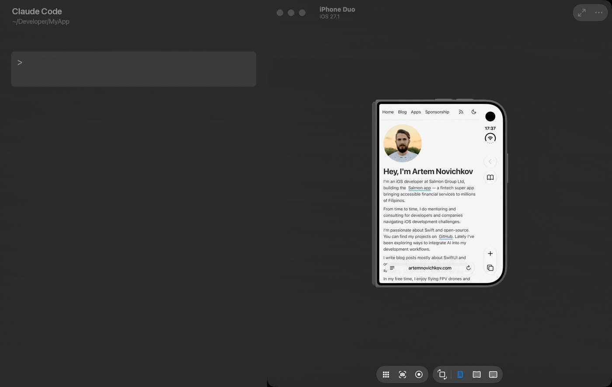

<p align="center">
  
</p>

<h1 align="center">hinge</h1>

<p align="center">
  <a href="https://github.com/artemnovichkov/hinge/releases/latest"></a>
  <a href="https://github.com/artemnovichkov/homebrew-tap"></a>
  <a href="https://skills.sh/artemnovichkov/hinge/hinge"></a>
  
  <a href="LICENSE"></a>
</p>

Let coding agents like Claude Code and Codex fold iPhone Duo while they build and verify your app. `hinge` ships as an [Agent Skill](https://agentskills.io) with a bundled CLI.



Ask the agent things like:

- *"Fold the simulator to 90° and take a screenshot of each display."*
- *"Check how the onboarding screen looks on the cover and on the inner display."*
- *"Unfold the simulator, rotate it to landscape, and verify the sidebar layout."*

## Why

Xcode's Device Hub has a hidden hinge slider (hold Option), but nothing scriptable can fold the device, so an agent has no way to test the inner display. Worse, the closest tools exit 0 and change nothing, so an agent carries on as if they worked:

| You want to… | What Xcode offers | `hinge` |
|---|---|---|
| Fold or unfold | No `simctl` or `devicectl` command for the hinge | `hinge close`, `open`, `half`, `hinge <degrees>`, `sweep` |
| Know the fold happened | No public way to read the angle back; `devicectl` 651 has no `motion` command | Waits until CoreMotion reports the angle, and fails if it doesn't |
| Know which display shows the app | Nothing tells it apart from the hinge angle | `hinge posture` names the active display |
| Screenshot what's showing | `simctl io screenshot` fails with `Invalid argument` on a foldable | `hinge screenshot` captures the active display |
| Rotate | `devicectl device orientation set` reports success and is reverted | `hinge rotate`, `orient` |
| Target the right simulator | `booted` picks one of several booted simulators | Picks the only booted iPhone Duo, and never guesses |

## Requirements

- macOS with Xcode 27.1 or later and a foldable iOS Simulator runtime
- A booted foldable simulator, such as iPhone Duo

## Installation

[`skills/hinge`](skills/hinge) is self-contained: it bundles the CLI, so the agent needs nothing else.

**[skills.sh](https://skills.sh)** (Claude Code, Codex, Cursor, and other agents):

```bash
npx skills add artemnovichkov/hinge
```

**[OpenSkills](https://github.com/numman-ali/openskills)** (any agent that reads `AGENTS.md`):

```bash
npx openskills install artemnovichkov/hinge
npx openskills sync
```

**Claude Code plugin:**

```
/plugin marketplace add artemnovichkov/hinge
/plugin install hinge@hinge
```

**Manually:**

```bash
git clone https://github.com/artemnovichkov/hinge.git
cp -R hinge/skills/hinge ~/.claude/skills/   # Claude Code
cp -R hinge/skills/hinge ~/.codex/skills/    # Codex
```

The first run compiles a small helper with Xcode's clang and caches it in `~/.cache/hinge`.
The cache keeps one build per helper version and Xcode version, and nothing prunes it.

## What the skill teaches the agent

A foldable has a few traps that make a naive agent report success when nothing changed. The skill covers them:

- **Confirmed folds.** Setting an angle waits until CoreMotion reports it, so a non-zero exit means the fold did not happen. The agent doesn't poll to check.
- **Display switches.** The angle and the active display are different things. The agent waits 1-2.5 s after a fold and checks which display hosts the UI with `posture` instead of assuming.
- **Screenshots.** A foldable has two displays, and `simctl` fails with `Invalid argument` unless it is told which one to capture. The agent uses `hinge screenshot`, which captures the display that hosts the UI.
- **The right simulator.** With several simulators booted, `hinge` picks the only iPhone Duo and refuses to guess between several.
- **Orientation.** `devicectl` reports success on a foldable but changes nothing. The agent rotates with Device Hub's own event.
- **Protocol changes.** When an angle is not confirmed, the agent reports that the private protocol has likely changed.

## CLI

The same tool works without an agent: from the terminal, scripts, or CI.

```bash
hinge 120            # set the angle: 0 = closed, 180 = flat
hinge get            # 120.0
hinge sweep 180 0 2  # fold closed over 2 seconds
hinge posture        # angle, orientation, and the active display
hinge screenshot out.png  # capture the display that hosts the UI
hinge posture --json # the same as JSON, for scripts
```

### Installation

**Homebrew:**

```bash
brew install artemnovichkov/tap/hinge
```

**From source:**

```bash
git clone https://github.com/artemnovichkov/hinge.git
ln -s "$PWD/hinge/bin/hinge" /usr/local/bin/hinge
```

When `hinge` is on `PATH`, the skill can use it instead of its bundled copy.

**On CI**, on a macOS runner with Xcode 27.1 and the iOS 27.1 simulator runtime:

```bash
brew install artemnovichkov/tap/hinge
UDID=$(xcrun simctl create ci-duo "iPhone Duo" com.apple.CoreSimulator.SimRuntime.iOS-27-1)
xcrun simctl bootstatus "$UDID" -b
export HINGE_DEVICE="$UDID"

hinge open
sleep 2.5                      # the display switches 1-2.5 s after the angle
hinge screenshot unfolded.png
hinge close
sleep 2.5
hinge screenshot folded.png
```

The first `hinge` call builds the helper, which takes a few seconds.

**Uninstall:**

```bash
brew uninstall hinge   # or, from source: rm /usr/local/bin/hinge
rm -rf ~/.cache/hinge
```

### Usage

```
Usage: hinge [-d <device>] [-t <seconds>] [--json] <command>

Commands:
  <degrees>                   Set hinge angle, 0 (closed) to 180 (flat)
  set <degrees>               Same as above
  open                        Unfold flat (180°)
  close                       Fold closed (0°)
  half                        Half-open (90°)
  sweep <from> <to> [seconds] Animate between two angles (default 1s)
  get                         Print current hinge angle
  posture                     Print the angle, orientation, and integrated displays
  screenshot <path>           Save a PNG of the display that hosts the UI
  rotate <left|right>         Rotate 90°, like Device Hub's Rotate Left/Right
  orient <orientation>        Set orientation: portrait, landscape-left, landscape-right,
                              portrait-upside-down
  orientation                 Print current orientation
  help                        Show this help

Options:
  -d, --device <device>       Simulator UDID or name (default: $HINGE_DEVICE, else
                              the only booted iPhone Duo)
  -t, --timeout <seconds>     Seconds to confirm a new angle (default 2, 0 to skip)
  -j, --json                  Print JSON (get, posture, orientation, screenshot)
  -h, --help                  Show this help
  -v, --version               Print version
```

#### Setting the angle

`open`, `close` and `half` also take `unfolded`/`flat`, `closed`/`folded` and `half-open`.
`half` is 90°; Device Hub's own half-open preset is 130° (`hinge 130`).

Setting an angle waits until CoreMotion reports it, so a change the simulator ignores
is an error instead of a silent success. That also means `hinge 90` on a simulator
without a hinge fails. `-t 0` sends the event without waiting.

#### Choosing a simulator

Without `-d`, `hinge` uses the only booted iPhone Duo, so other booted simulators
don't get in the way. With several iPhone Duos booted it lists them and exits;
pass `-d` with a UDID or name, or set `HINGE_DEVICE`. When no iPhone Duo is booted,
it falls back to the only booted simulator, which `rotate` and `orient` still work on.

#### Posture and screenshots

`posture` adds the display side of a fold, from `devicectl`:

```
$ hinge posture
device: iPhone Duo (34E69195-B9FF-4C56-816F-9DFFB8149FBB)
angle: 180.0
orientation: portrait
display: LCD (primary) (backlight: off)
display: LCD-1 (active) (backlight: activeOn)
```

On the iPhone Duo, `LCD` is the cover display and `LCD-1` the inner one. The `active`
flag is what tells which display hosts the UI, not the backlight: a locked device keeps
its display active with the backlight dimmed, a folded iPhone Duo lights its cover as
`inactiveOn`, and the backlight follows a fold up to 3 s after `active` does. The switch
itself takes 1-2.5 s after the angle changes, so give it a moment before you capture
the screen.

`hinge screenshot <path>` captures the display that hosts the UI. If that display's
backlight is still off, it waits up to 2 s for it to come on.

```bash
hinge screenshot out.png  # cover when folded, inner when unfolded
```

Plain `simctl` has to be told which display to capture — without `--display` it fails
with `Invalid argument`:

```bash
xcrun simctl io booted screenshot --display=LCD cover.png    # 1398x2034
xcrun simctl io booted screenshot --display=LCD-1 inner.png  # 2853x2007
```

The numeric ids work too: `1` for the cover, `3` for the inner display.

#### JSON

`get`, `posture`, `orientation` and `screenshot` print JSON with `--json`:

```
$ hinge posture --json
{
  "device": {"udid": "34E69195-B9FF-4C56-816F-9DFFB8149FBB", "name": "iPhone Duo"},
  "angle": 0.0,
  "orientation": "portrait",
  "activeDisplay": "LCD",
  "displays": [
    {"name": "LCD", "id": 1, "primary": true, "active": true, "backlight": "inactiveOn", "rotation": "rot0", "size": [1398, 2034], "scale": 3},
    {"name": "LCD-1", "id": 3, "primary": false, "active": false, "backlight": "off", "rotation": "rot90", "size": [2007, 2853], "scale": 3}
  ]
}
```

`angle` is `null` on a simulator without a hinge, and `size` is in pixels.

#### Orientation

`rotate` and `orient` send Device Hub's orientation event, which only foldables follow.
Other simulators ignore it, so `hinge` falls back to `xcrun devicectl device orientation set`
there — on a foldable that command reports success without changing anything, which is
why the event goes first.

## How it works

The hinge slider in Device Hub sends a vendor-defined HID event to the simulator through CoreDevice:

| Field | Value |
|---|---|
| Usage page | `0xFF61` |
| Usage | `0x5B` |
| Data | Binary-serialized dictionary: `provider = "com.apple.Virtualization.VirtualMachines"`, `source = "hinge-slider-control"`, `type = "range"`, `value = <degrees>` |

Device Hub's Rotate Left/Right on a foldable sends an event on the same usage page and usage, with `source = "orientation-picker-control"`, `type = "enum"`, and `value` set to the target orientation: `portrait`, `landscape-left`, `landscape-right`, or `pud` (portrait upside down). The simulator does not check `provider`; `hinge` sends Device Hub's value for both events.

`hinge` builds a small helper for the iOS Simulator SDK and runs it inside the simulator with `xcrun simctl spawn`. The helper creates the same event and dispatches it through the simulator's `IOHIDEventSystem`. The current angle is read back from CoreMotion's private `CMAngleManager`, the same source UIKit's `UIHinge` reads.

## Limitations

- Simulator only. Physical devices are not supported.
- The protocol is private and undocumented. It was verified with Xcode 27.1 and 27.2 on the iOS 27.1 runtime and may break with future releases.
- The Device Hub slider doesn't move when the angle changes from `hinge`.
- Setting the angle and switching the display are two different things. `hinge` confirms the angle from CoreMotion; which display becomes active is left to the simulator, and it is not guaranteed. At an angle between 0° and 180° the result depends on the path the hinge took: a jump from 0° to 90° switches to the inner display, while 5° steps up to 90° stay on the cover, so a slow `sweep` can keep the previous display active until it reaches the end. Even 0° and 180° can be ignored — a simulator sometimes stops following the hinge while still reporting every new angle. Check the result with `posture`.
- `orient`, `orientation` and `rotate` use **device** orientations, the names `devicectl` reports. They are not interface orientations: a device in `landscape-right` shows a `landscape-left` interface.

## Troubleshooting

| Message | Cause |
|---|---|
| `this simulator reports no hinge` | The simulator has no hinge: it is not a foldable, or its runtime is older than iOS 27.1. |
| `the hinge angle did not reach <n>` | The event went out but nothing moved. Most likely the private protocol changed in a newer Xcode; `-t 0` sends without the check. |
| `failed to build helper` | `xcode-select -p` points at an Xcode without a foldable simulator SDK. Switch it with `sudo xcode-select -s /Applications/Xcode.app`. |
| `no booted simulator` | Boot one: `xcrun simctl boot "iPhone Duo"`. |
| `several iPhone Duo simulators are booted` / `no booted iPhone Duo` | `hinge` doesn't guess between simulators. Pass `-d <udid\|name>` or set `HINGE_DEVICE`. |
| `posture` keeps naming the same `(active)` display after a fold | The simulator stopped following the hinge, although the angle still changes — unfolding to 180° can keep working while folding back to 0° no longer switches to the cover. Send the angle again after 1-2.5 s; if it persists, shut the simulator down and boot it again. |
| `Invalid argument` from `simctl io … screenshot` | A foldable has two displays; use `hinge screenshot` or pass `--display` (see [Posture and screenshots](#posture-and-screenshots)). |

## Contributing

Issues and pull requests are welcome. [CONTRIBUTING.md](CONTRIBUTING.md) describes the release workflow.

## Author

Artem Novichkov, https://artemnovichkov.com/

## License

The project is available under the MIT license. See the [LICENSE](./LICENSE) file for more info.
