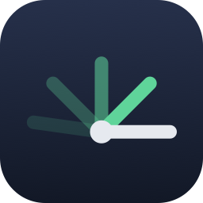

<p align="center">
  
</p>

<h1 align="center">hinge</h1>

<p align="center">
  <a href="https://github.com/artemnovichkov/hinge/releases/latest"></a>
  <a href="https://github.com/artemnovichkov/homebrew-tap"></a>
  <a href="https://skills.sh/artemnovichkov/hinge/hinge"></a>
  
  <a href="LICENSE"></a>
</p>

Control the hinge angle of a foldable iPhone Simulator (iPhone Duo) from the command line, from scripts, or from AI coding agents like Claude Code and Codex.

https://github.com/user-attachments/assets/758de2a9-10eb-4972-96a0-fd04e433267d

```bash
hinge 120            # set the angle: 0 = closed, 180 = flat
hinge get            # 120.0
hinge sweep 180 0 2  # fold closed over 2 seconds
hinge posture        # angle, orientation, and the active display
```

Xcode's Device Hub has a hidden hinge slider (hold Option), but there is no `simctl` or `devicectl` command to set the angle. `hinge` fills that gap.

## Requirements

- macOS with Xcode 27.1 or later and a foldable iOS Simulator runtime
- A booted foldable simulator, such as iPhone Duo

## Installation

**Homebrew:**

```bash
brew install artemnovichkov/tap/hinge
```

**From source:**

```bash
git clone https://github.com/artemnovichkov/hinge.git
ln -s "$PWD/hinge/bin/hinge" /usr/local/bin/hinge
```

The first run compiles a small helper with Xcode's clang and caches it in `~/.cache/hinge`.
The cache keeps one build per helper version and Xcode version, and nothing prunes it.

**Uninstall:**

```bash
brew uninstall hinge   # or, from source: rm /usr/local/bin/hinge
rm -rf ~/.cache/hinge
```

## Usage

```
Usage: hinge [-d <device>] [-t <seconds>] <command>

Commands:
  <degrees>                   Set hinge angle, 0 (closed) to 180 (flat)
  set <degrees>               Same as above
  open                        Unfold flat (180°)
  close                       Fold closed (0°)
  half                        Half-open (90°)
  sweep <from> <to> [seconds] Animate between two angles (default 1s)
  get                         Print current hinge angle
  posture                     Print the angle, orientation, and integrated displays
  rotate <left|right>         Rotate 90°, like Device Hub's Rotate Left/Right
  orient <orientation>        Set orientation: portrait, landscape-left, landscape-right,
                              portrait-upside-down
  orientation                 Print current orientation
  help                        Show this help

Options:
  -d, --device <device>       Simulator UDID, name, or "booted" (default)
  -t, --timeout <seconds>     Seconds to confirm a new angle (default 2, 0 to skip)
  -h, --help                  Show this help
  -v, --version               Print version
```

### Setting the angle

`open`, `close` and `half` also take `unfolded`/`flat`, `closed`/`folded` and `half-open`.
`half` is 90°; Device Hub's own half-open preset is 130° (`hinge 130`).

Setting an angle waits until CoreMotion reports it, so a change the simulator ignores
is an error instead of a silent success. That also means `hinge 90` on a simulator
without a hinge fails. `-t 0` sends the event without waiting.

### Posture and screenshots

`posture` adds the display side of a fold, from `devicectl`:

```
$ hinge posture
angle: 180.0
orientation: portrait
display: LCD (primary)
display: LCD-1 (active)
```

On the iPhone Duo, `LCD` is the cover display and `LCD-1` the inner one. The `active`
flag is what tells which display hosts the UI; a locked device keeps its display
active with the backlight dimmed. The switch takes 1-2.5 s after the angle changes,
so give it a moment before you capture the screen.

Because a foldable has two displays, `simctl` has to be told which one to capture —
without `--display` it fails with `Invalid argument`:

```bash
xcrun simctl io booted screenshot --display=LCD cover.png    # 2034x1398
xcrun simctl io booted screenshot --display=LCD-1 inner.png  # 2853x2007
```

The numeric ids work too: `1` for the cover, `3` for the inner display.

### Orientation

`rotate` and `orient` send Device Hub's orientation event, which only foldables follow.
Other simulators ignore it, so `hinge` falls back to `xcrun devicectl device orientation set`
there — on a foldable that command reports success without changing anything, which is
why the event goes first.

## Agent skill

[`skills/hinge`](skills/hinge) is a self-contained [Agent Skill](https://agentskills.io) that bundles the CLI. It lets an agent fold the simulator while verifying your app.

**[skills.sh](https://skills.sh)** (Claude Code, Codex, Cursor, and other agents):

```bash
npx skills add artemnovichkov/hinge
```

**Claude Code plugin:**

```
/plugin marketplace add artemnovichkov/hinge
/plugin install hinge@hinge
```

**Manually:**

```bash
cp -R hinge/skills/hinge ~/.claude/skills/   # Claude Code
cp -R hinge/skills/hinge ~/.codex/skills/    # Codex
```

Then ask the agent something like *"fold the simulator to 90° and take a screenshot"*.

## How it works

The hinge slider in Device Hub sends a vendor-defined HID event to the simulator through CoreDevice:

| Field | Value |
|---|---|
| Usage page | `0xFF61` |
| Usage | `0x5B` |
| Data | Binary-serialized dictionary: `provider = "com.apple.Virtualization.VirtualMachines"`, `source = "hinge-slider-control"`, `type = "range"`, `value = <degrees>` |

Device Hub's Rotate Left/Right on a foldable sends an event on the same usage page and usage, with `source = "orientation-picker-control"`, `type = "enum"`, and `value` set to the target orientation: `portrait`, `landscape-left`, `landscape-right`, or `pud` (portrait upside down). The simulator does not check `provider`; `hinge` sends Device Hub's value for both events.

`hinge` builds a small helper for the iOS Simulator SDK and runs it inside the simulator with `xcrun simctl spawn`. The helper creates the same event and dispatches it through the simulator's `IOHIDEventSystem`. The current angle is read back from CoreMotion's private `CMAngleManager`, the same source UIKit's `UIHinge` reads.

## Limitations

- Simulator only. Physical devices are not supported.
- The protocol is private and undocumented. It was verified with Xcode 27.1 and 27.2 on the iOS 27.1 runtime and may break with future releases.
- The Device Hub slider doesn't move when the angle changes from `hinge`.
- Setting the angle and switching the display are two different things. `hinge` confirms the angle from CoreMotion; which display becomes active is left to the simulator, and it is not guaranteed. At an angle between 0° and 180° the result depends on the path the hinge took: a jump from 0° to 90° switches to the inner display, while 5° steps up to 90° stay on the cover, so a slow `sweep` can keep the previous display active until it reaches the end. Even 0° and 180° can be ignored — a simulator sometimes stops following the hinge while still reporting every new angle. Check the result with `posture`.
- `orient`, `orientation` and `rotate` use **device** orientations, the names `devicectl` reports. They are not interface orientations: a device in `landscape-right` shows a `landscape-left` interface.

## Troubleshooting

| Message | Cause |
|---|---|
| `this simulator reports no hinge` | The simulator has no hinge: it is not a foldable, or its runtime is older than iOS 27.1. |
| `the hinge angle did not reach <n>` | The event went out but nothing moved. Most likely the private protocol changed in a newer Xcode; `-t 0` sends without the check. |
| `failed to build helper` | `xcode-select -p` points at an Xcode without a foldable simulator SDK. Switch it with `sudo xcode-select -s /Applications/Xcode.app`. |
| `no booted simulator` | Boot one: `xcrun simctl boot "iPhone Duo"`. |
| `posture` keeps naming the same `(active)` display after a fold | The simulator stopped following the hinge, although the angle still changes — unfolding to 180° can keep working while folding back to 0° no longer switches to the cover. Send the angle again after 1-2.5 s; if it persists, shut the simulator down and boot it again. |
| `Invalid argument` from `simctl io … screenshot` | A foldable has two displays; pass `--display` (see [Posture and screenshots](#posture-and-screenshots)). |

## Contributing

Issues and pull requests are welcome. [CONTRIBUTING.md](CONTRIBUTING.md) describes the release workflow.

## Author

Artem Novichkov, https://artemnovichkov.com/

## License

The project is available under the MIT license. See the [LICENSE](./LICENSE) file for more info.
